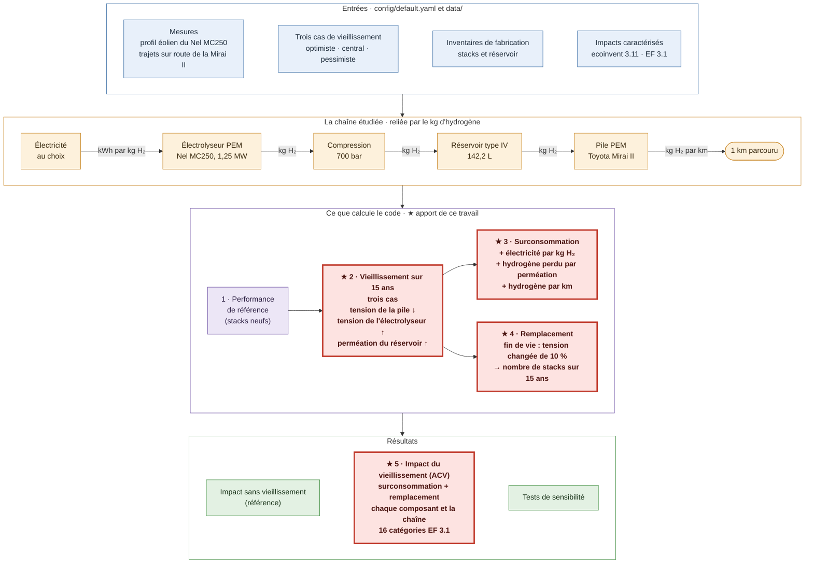

# h2-ageing-lca

[English](README.md) | **Français**

**De combien le vieillissement des stacks change-t-il l'analyse du cycle de vie d'une chaîne de mobilité hydrogène ?**

Code : MIT · Données : CC BY 4.0

Ce dépôt contient les modèles, les données et le code d'une analyse du cycle de vie (ACV) qui tient compte du vieillissement des stacks électrochimiques d'une chaîne hydrogène : un électrolyseur PEM, la compression, un réservoir de type IV et une pile à combustible PEM. Chaque résultat se recalcule avec une seule commande, et chaque valeur d'entrée se change dans un seul fichier de configuration.

---

## Sommaire

1. [Pourquoi ce dépôt et ce qu'il apporte](#1-pourquoi-ce-dépôt-et-ce-quil-apporte)
2. [Qui peut l'utiliser, et pour quoi](#2-qui-peut-lutiliser-et-pour-quoi)
3. [Ce que fait le code](#3-ce-que-fait-le-code)
4. [Démarrage rapide, sans et avec licence ecoinvent](#4-démarrage-rapide-sans-et-avec-licence-ecoinvent)
5. [Documentation](#5-documentation)
6. [Résultats principaux](#6-résultats-principaux)
7. [Citer, licence, contact](#7-citer-licence-contact)

---

## 1. Pourquoi ce dépôt et ce qu'il apporte

La plupart des ACV de la mobilité hydrogène supposent des stacks qui ne vieillissent jamais : le même rendement pendant 15 ans et un seul stack. Or un stack s'use et doit être remplacé. Ce dépôt mesure ce que cet oubli change :

- **De combien ?** La hausse de l'impact due au vieillissement, pour chaque composant et pour la chaîne.
- **Par quelle voie ?** La **surconsommation** (plus d'hydrogène par km, plus d'électricité par kg, plus de pertes du réservoir) et le **remplacement** (un stack neuf quand la tension a varié de 10 %, critère du DOE).

**Ce que ce dépôt apporte**

- **Une méthode complète, prête à l'emploi** : vieillissement, fin de vie, nombre de stacks et ACV sont reliés, chaque équation est sourcée ([docs/METHOD.fr.md](docs/METHOD.fr.md)).
- **Des modèles fondés sur des mesures réelles** : une pile de Toyota Mirai II sur route, un électrolyseur Nel MC250 sous profil éolien (données du NLR).
- **Tout se change sans toucher au code** : une valeur dans un fichier de configuration, un inventaire dans un tableau CSV ; le reste est recalculé.
- **Avec ou sans licence ecoinvent** : les deux façons sont décrites ([section 4](#4-démarrage-rapide-sans-et-avec-licence-ecoinvent)).
- **Fiable et ouvert** : des tests vérifient les résultats à chaque modification ; chaque page existe en français et en anglais.

## 2. Qui peut l'utiliser, et pour quoi

| Vous êtes | Ce que vous pouvez faire | Par où commencer |
|---|---|---|
| **Praticien de l'ACV** | Ajouter le vieillissement à une ACV de la mobilité hydrogène ; tester votre propre mix électrique, horizon, inventaire ou règle de comptage des stacks | [docs/GUIDE.fr.md](docs/GUIDE.fr.md#5-exemples-commentés), exemples 1 à 3 et 9 |
| **Ingénieur ou constructeur** | Voir ce que vaut, en CO2-éq, un stack qui dure plus longtemps ou qui se dégrade moins vite ; trouver la durée de vie qui évite un remplacement | `scripts/threshold.py`, exemple 4 |
| **Chercheur sur la dégradation** | Brancher vos propres constantes ou votre propre loi de vieillissement et voir l'effet sur l'ACV, sans réécrire l'ACV | [docs/GUIDE.fr.md](docs/GUIDE.fr.md#5-exemples-commentés), exemples 5 et 7 |
| **Étudiant** | Lire un petit modèle complet d'ACV avec vieillissement, le lancer et le modifier pas à pas | [docs/METHOD.fr.md](docs/METHOD.fr.md), puis les notebooks |

## 3. Ce que fait le code

**Lecture du schéma, étape par étape :**

1. **Performance de référence** : à partir des mesures, le code ajuste la courbe de polarisation de l'électrolyseur et de la pile à l'état neuf.
2. **Vieillissement** : il fait vieillir chaque composant sur 15 ans selon le cas choisi ([les trois cas](docs/METHOD.fr.md#les-trois-cas-de-vieillissement)) : la tension de la pile baisse, celle de l'électrolyseur monte, la perméation du réservoir augmente.
3. **Surconsommation** : à partir de ces changements, il calcule ce que la chaîne consomme en plus :
   - l'électrolyseur demande plus d'électricité par kg d'hydrogène ;
   - le réservoir perd plus d'hydrogène par perméation ;
   - la pile consomme plus d'hydrogène par km, donc il faut produire et comprimer plus d'hydrogène.
4. **Remplacement** : il trouve l'âge où la tension a changé de 10 % (fin de vie), puis le nombre de stacks nécessaires sur 15 ans.
5. **Résultats (ACV)** : il multiplie la surconsommation et le nombre de stacks par les impacts caractérisés. On obtient l'impact de la surconsommation et celui du remplacement, donc la hausse due au vieillissement, pour chaque composant et pour la chaîne, dans les 16 catégories EF 3.1.

Les cases marquées ★ sont l'apport de ce travail. Le détail de chaque étape est dans [docs/METHOD.fr.md](docs/METHOD.fr.md).

## 4. Démarrage rapide, sans et avec licence ecoinvent

| | Sans licence ecoinvent | Avec une licence ecoinvent |
|---|---|---|
| **Vous pouvez changer** | toutes les entrées du modèle, et l'impact de fabrication en donnant votre propre valeur | en plus, le contenu des inventaires de fabrication (matériaux, énergie, données ecoinvent, lieu) |
| **Vous ne pouvez pas** | recalculer un impact depuis ecoinvent (inventaire modifié, nouveau composant, nouvelle électricité) | modifier les données ecoinvent elles-mêmes |
| **À installer** | `requirements.txt` | `requirements.txt` et `requirements-brightway.txt` |

Le détail de ce qui se change est dans [docs/GUIDE.fr.md](docs/GUIDE.fr.md), section 3.

**Installer et lancer** (terminal ou Jupyter, avec ou sans Git) : [docs/GUIDE.fr.md](docs/GUIDE.fr.md#1-installer-et-lancer), section 1. Ensuite, sans licence, changez une valeur ou un cas (sections 2 et 3) ; avec une licence, recalculez les impacts de fabrication avec Brightway ([section 3.4](docs/GUIDE.fr.md#34-fabrication)).

## 5. Documentation

| Document | Ce qu'on y trouve |
|---|---|
| [docs/METHOD.fr.md](docs/METHOD.fr.md) | chaque équation et sa source, l'ACV, la sensibilité, les résultats détaillés |
| [docs/GUIDE.fr.md](docs/GUIDE.fr.md) | installer, organisation du dépôt, changer une valeur, tout ce qui se change, reproduire chaque résultat, exemples commentés |
| [docs/LIMITS.fr.md](docs/LIMITS.fr.md) | les limites, leur effet et le domaine de validité |
| [data/README.fr.md](data/README.fr.md) | les sources et licences de chaque fichier de données |
| [data/inventories/README.fr.md](data/inventories/README.fr.md) | les inventaires de fabrication et leurs données ecoinvent |
| [examples/](examples/) | notebooks Jupyter prêts à lancer |
| [notebooks/](notebooks/README.fr.md) | notebooks de recherche d'origine |

## 6. Résultats principaux

**En bref.** Sur la vie du véhicule (200 000 km, objectif de Toyota pour la pile ; 15 ans, durée de certification du réservoir), le vieillissement des stacks augmente l'impact de la chaîne sur le changement climatique de **+5,0 %** (cas optimiste), **+31,1 %** (cas central) et **+35,0 %** (cas pessimiste), par rapport à la même chaîne sans vieillissement.

Configuration par défaut : changement climatique (EF 3.1), mix résiduel français (79,6 g CO2-éq/kWh, données AIB 2024), 200 000 km en 15 ans. « Sans vieillissement » : la même chaîne avec des stacks qui ne vieillissent jamais. Chaque valeur comprend l'usage et la fabrication.

| | Sans vieillissement | Optimiste | Central | Pessimiste |
|---|---|---|---|---|
| Stacks de pile sur 15 ans | 1 | 1 | 2 | 2 |
| Stacks d'électrolyseur sur 15 ans | 1 | 2 | 3 | 3 |
| Électrolyseur seul (kg CO2-éq/kg H2) | 4,31 | 4,53 (+5,1 %) | 4,57 (+5,9 %) | 4,66 (+8,2 %) |
| Réservoir seul (g CO2-éq/km) | 11,89 | 11,89 (0,0 %) | 12,04 (+1,3 %) | 12,64 (+6,4 %) |
| Pile seule (g CO2-éq/km) | 61,9 | 63,4 (+2,4 %) | 82,2 (+32,8 %) | 83,4 (+34,6 %) |
| **Chaîne complète (g CO2-éq/km)** | **74,1** | **77,8 (+5,0 %)** | **97,2 (+31,1 %)** | **100,1 (+35,0 %)** |

- **La pile est dominée par le remplacement** : dans le cas central, 91 % de sa hausse vient du second stack.
- **L'électrolyseur est dominé par la surconsommation** : un stack est réparti sur 1,19 million de kg d'hydrogène, l'électricité en plus pèse davantage.

Décomposition détaillée (usage et fabrication, deux voies par composant) et explication de chaque résultat : [docs/METHOD.fr.md](docs/METHOD.fr.md#7-résultats-détaillés). Limites et domaine de validité : [docs/LIMITS.fr.md](docs/LIMITS.fr.md).

## 7. Citer, licence, contact

- **Citer :** voir [CITATION.cff](CITATION.cff) (GitHub affiche un bouton « Cite this repository »).
- **Licence :** code sous licence MIT ([LICENSE](LICENSE)) ; données et documentation sous CC BY 4.0 ([LICENSE-DATA.md](LICENSE-DATA.md)). Les sources tierces gardent leurs propres conditions ([data/README.fr.md](data/README.fr.md)).
- **Questions, erreurs ou nouvelles données :** ouvrez une *Issue* sur GitHub. Les données de dégradation mesurées sur des stacks commerciaux sont particulièrement bienvenues, car elles remplaceraient les cas d'encadrement par une mesure.
