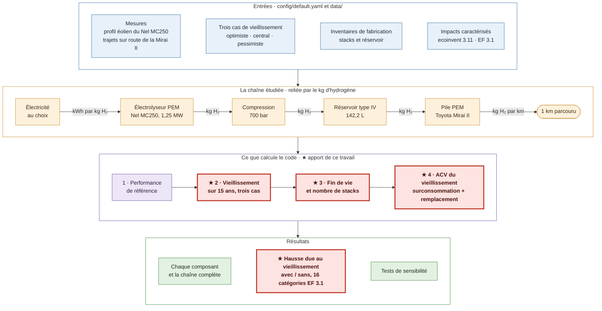

# h2-ageing-lca

[English](README.md) | **Français**

**De combien le vieillissement des stacks change-t-il l'analyse du cycle de vie d'une chaîne de mobilité hydrogène ?**

[](https://github.com/Ayabh12/h2-ageing-lca/actions/workflows/tests.yml)
Code : MIT · Données : CC BY 4.0

Ce dépôt contient les modèles, les données et le code d'une analyse du cycle de vie (ACV) qui tient compte du vieillissement des stacks électrochimiques d'une chaîne hydrogène : un électrolyseur PEM, la compression, un réservoir de type IV et une pile à combustible PEM. Chaque résultat se recalcule avec une seule commande, et chaque valeur d'entrée se change dans un seul fichier de configuration.

---

## Sommaire

1. [Pourquoi c'est important](#1-pourquoi-cest-important)
2. [Qui peut l'utiliser, et pour quoi](#2-qui-peut-lutiliser-et-pour-quoi)
3. [Ce que fait le code](#3-ce-que-fait-le-code)
4. [Utilisation sans et avec licence ecoinvent](#4-utilisation-sans-et-avec-licence-ecoinvent)
5. [L'utiliser et l'adapter : six niveaux, avec exemples](#5-lutiliser-et-ladapter--six-niveaux-avec-exemples)
6. [Reproduire chaque résultat](#6-reproduire-chaque-résultat)
7. [Organisation du dépôt](#7-organisation-du-dépôt)
8. [Données et ecoinvent](#8-données-et-ecoinvent)
9. [Limites](#9-limites)
10. [Résultats principaux](#10-résultats-principaux)
11. [Citer, licence, contact](#11-citer-licence-contact)

Documentation complémentaire : [méthode](docs/METHOD.fr.md) · [utiliser et adapter le modèle, avec des exemples](docs/GUIDE.fr.md) · [limites et domaine de validité](docs/LIMITS.fr.md) · [données](data/README.fr.md) · [notebooks de recherche](notebooks/README.fr.md)

---

## 1. Pourquoi c'est important

La plupart des ACV de la mobilité hydrogène traitent l'électrolyseur et la pile à combustible comme s'ils ne vieillissaient jamais : le même rendement pendant 15 ans et un seul stack. En réalité, un stack perd en performance avec l'usage et doit être remplacé en fin de vie. Ignorer ce phénomène sous-estime l'impact, mais on ne savait pas de combien.

Ce dépôt répond à deux questions :

- **De combien ?** La hausse de l'impact due au vieillissement, pour chaque composant seul et pour la chaîne complète.
- **Par quelle voie ?** Le vieillissement agit à deux niveaux :
  1. **La surconsommation** : la pile vieillie consomme plus d'hydrogène par km, l'électrolyseur plus d'électricité par kg, et le réservoir perd plus d'hydrogène.
  2. **Le remplacement** : un stack est remplacé quand sa tension a varié de 10 % (critère du DOE) ; chaque stack neuf ajoute son impact de fabrication.

**Le résultat en bref.** Sur la vie du véhicule (15 ans, 200 000 km), le vieillissement des stacks augmente l'impact de la chaîne sur le changement climatique, par rapport à la même chaîne sans vieillissement, de :

- **+5,0 %** dans le cas **optimiste** : modèle linéaire, avec les objectifs du DOE (durée de vie de la pile, vitesse de dégradation de l'électrolyseur) ;
- **+31,1 %** dans le cas **central** : modèle linéaire, avec l'état actuel mesuré par le DOE sur des systèmes réels ;
- **+35,0 %** dans le cas **pessimiste** : modèle semi-empirique, plus détaillé, qui décrit la dégradation des matériaux du stack (pour la pile : perte de surface active du platine, hausse de la résistance, crossover de la membrane ; pour l'électrolyseur : perte d'activité de l'anode, hausse de la résistance, amincissement de la membrane), avec des constantes mesurées sur des cellules de laboratoire.

Ce dépôt permet à chacun de recalculer ce résultat pour son propre cas.

**Ce que ce dépôt apporte**

- **Une méthode prête à l'emploi.** Les modèles de vieillissement, la recherche de la fin de vie, le comptage des stacks et l'ACV sont déjà reliés entre eux, et chaque équation est documentée avec sa source ([docs/METHOD.fr.md](docs/METHOD.fr.md)).
- **N'importe quelle valeur ou n'importe quel inventaire se change sans réécrire le code.** Les valeurs d'entrée sont dans un seul fichier de configuration, les inventaires de fabrication dans des tableaux CSV ; après un changement, la fin de vie, le nombre de stacks et l'impact sont recalculés automatiquement.
- **Des modèles construits sur des mesures réelles** : une pile de Toyota Mirai II enregistrée sur route, et un électrolyseur Nel MC250 qui suit un profil de production éolienne (données publiques du NLR).
- **Utilisable sans licence ecoinvent**, et complet avec une licence : les deux façons de faire sont décrites pas à pas ([section 4](#4-utilisation-sans-et-avec-licence-ecoinvent)).
- **Des résultats contrôlés automatiquement** : des tests vérifient les résultats à chaque modification du dépôt.
- **Ouvert et bilingue** : chaque page existe en français et en anglais, et n'importe qui peut reproduire les résultats ou tester son propre cas.

**À essayer en une commande.** Si la pile dure 6 000 h au lieu de 4 100 h, un seul stack suffit sur toute la vie du véhicule, et la hausse du cas central passe de +31,1 % à +6,4 % :

```bash
python scripts/run.py --set cases.central.fuel_cell.hours_to_end_of_life=6000
```

## 2. Qui peut l'utiliser, et pour quoi

| Vous êtes | Ce que vous pouvez faire | Par où commencer |
|---|---|---|
| **Praticien de l'ACV** | Ajouter le vieillissement à une ACV de la mobilité hydrogène ; tester votre propre mix électrique, horizon, inventaire ou règle de comptage des stacks | [docs/GUIDE.fr.md](docs/GUIDE.fr.md#5-exemples-commentés), exemples 1 à 3 et 9 |
| **Ingénieur ou constructeur** | Voir ce que vaut, en CO2-éq, un stack qui dure plus longtemps ou qui se dégrade moins vite ; trouver la durée de vie qui évite un remplacement | `scripts/threshold.py`, exemple 4 |
| **Chercheur sur la dégradation** | Brancher vos propres constantes ou votre propre loi de vieillissement et voir l'effet sur l'ACV, sans réécrire l'ACV | [docs/GUIDE.fr.md](docs/GUIDE.fr.md#5-exemples-commentés), exemples 5 et 7 |
| **Étudiant** | Lire un petit modèle complet d'ACV avec vieillissement, le lancer et le modifier pas à pas | [docs/METHOD.fr.md](docs/METHOD.fr.md), puis les notebooks |

## 3. Ce que fait le code



**Lecture du schéma, étape par étape :**

1. **Performance de référence** : à partir des mesures, le code ajuste une courbe de polarisation de l'électrolyseur et de la pile à l'état neuf.
2. **Vieillissement** : à partir de cette performance de référence, il fait vieillir chaque stack sur 15 ans selon le cas choisi ; la tension de la pile baisse, celle de l'électrolyseur monte.
3. **Fin de vie et nombre de stacks** : à partir de cette tension, il trouve l'âge où elle a varié de 10 %, puis le nombre de stacks nécessaires sur 15 ans.
4. **Flux de la chaîne** : à partir de la même tension, il calcule l'électricité par kg d'hydrogène et l'hydrogène par km ; leur hausse est la surconsommation.
5. **ACV** : il multiplie ces flux et le nombre de stacks par les impacts caractérisés, ce qui donne l'impact de la surconsommation et celui du remplacement.
6. **Résultats** : la hausse due au vieillissement, pour chaque composant et pour la chaîne, dans les 16 catégories EF 3.1.

Les cases marquées ★ sont l'apport de ce travail. Le détail de chaque étape est dans [docs/METHOD.fr.md](docs/METHOD.fr.md).

### Les trois cas de vieillissement

Aucune vitesse de dégradation n'est publiée pour les deux stacks étudiés. Faute de ces données, trois cas encadrent le vieillissement : l'objectif du DOE (optimiste), l'état réel mesuré par le DOE (central) et des constantes de laboratoire (pessimiste).

| | Optimiste | Central | Pessimiste |
|---|---|---|---|
| Modèle | linéaire | linéaire | semi-empirique |
| Pile | 8 000 h jusqu'à la fin de vie (objectif du DOE) | 4 100 h (meilleure flotte suivie par le DOE, 2006–2016) | constantes de laboratoire (Colombo et al. 2023) : fin de vie à 2 895 h |
| Électrolyseur | 2,3 µV/h par cellule (objectif 2026 du DOE) | 4,8 µV/h (statut 2022 du DOE) | constantes de laboratoire (Padgett et al. 2025 ; Chandesris et al. 2015) |
| Perméation du réservoir (mL/h/L, de 0 à 15 ans) | 6 → 6 | 6 → 14 | 6 → 46 (limite UN R134) |
| Ce qu'il représente | ce que vise la technologie | l'état actuel des systèmes réels | une borne haute, sur des cellules plus sollicitées que des stacks commerciaux |

Les exemples mettent en avant le cas central, parce qu'il repose sur des systèmes réels mesurés par le DOE ; l'optimiste et le pessimiste sont des bornes, l'une tirée d'objectifs, l'autre de cellules de laboratoire. Le cas central n'est pas une moyenne des deux autres, et les trois cas sont toujours donnés côte à côte. Les valeurs et leurs sources sont dans `cases` de `config/default.yaml`.

La méthode complète, avec chaque équation et sa source, est dans [docs/METHOD.fr.md](docs/METHOD.fr.md).

## 4. Utilisation sans et avec licence ecoinvent

Aucune donnée ecoinvent n'est distribuée, conformément à sa licence. Le modèle peut être utilisé de deux façons :

| | Sans licence ecoinvent | Avec une licence ecoinvent |
|---|---|---|
| Ce que vous pouvez faire | lancer le modèle, changer n'importe quelle entrée et reproduire tous les résultats | en plus, changer un inventaire de fabrication et recalculer son impact |
| Ce qui est utilisé | `data/impacts` : résultats caractérisés seulement (impact d'1 kWh, d'1 kg d'eau, d'un stack ou d'un réservoir fabriqué) | votre propre ecoinvent 3.11 cut-off, importé dans Brightway avec votre identifiant ecoinvent |
| Ce qu'il faut installer | `requirements.txt` | `requirements.txt` et `requirements-brightway.txt` |

### Installation

Prérequis : Python 3.10 ou plus récent, et Git (ou téléchargez le dépôt en ZIP : bouton vert **Code**, **Download ZIP**).

**Dans un terminal** (Anaconda Prompt, PowerShell, terminal macOS ou Linux) :

```bash
git clone https://github.com/Ayabh12/h2-ageing-lca
cd h2-ageing-lca
pip install -r requirements.txt
python scripts/run.py                    # configuration par défaut, environ 2 s
python tests/test_reference_results.py   # 13 tests : la configuration par défaut redonne les résultats de référence
```

**Dans Jupyter**, cette méthode marche partout, avec ou sans Git installé. Copiez ces deux cellules dans un nouveau notebook :

```python
# cellule 1 : télécharger le dépôt (sans Git) et installer, une seule fois
import sys, urllib.request, zipfile
urllib.request.urlretrieve("https://github.com/Ayabh12/h2-ageing-lca/archive/refs/heads/main.zip", "h2-ageing-lca.zip")
zipfile.ZipFile("h2-ageing-lca.zip").extractall(".")
%cd h2-ageing-lca-main
!{sys.executable} -m pip install -r requirements.txt
```

```python
# cellule 2 : lancer le modèle, puis vérifier les résultats de référence
!{sys.executable} scripts/run.py
!{sys.executable} tests/test_reference_results.py
```

Dans Jupyter, `!` lance une commande du terminal, `%cd` entre dans un dossier, et `{sys.executable}` désigne le Python du notebook. Si le dossier existe déjà, lancez seulement `import sys` puis `%cd h2-ageing-lca-main`. Un notebook prêt à lancer est aussi dans [examples/adapt_the_model.fr.ipynb](examples/adapt_the_model.fr.ipynb).

Dans les étapes ci-dessous, écrivez `!{sys.executable}` à la place de `python` si vous travaillez dans Jupyter.

### Sans licence ecoinvent

Le modèle utilise alors des impacts déjà calculés avec ecoinvent 3.11 (dans `data/impacts`, pour les 16 catégories EF 3.1) : l'impact d'**1 kWh** d'électricité pour chacune des cinq sources, d'**1 kg** d'eau déionisée, et de la **fabrication d'une unité** de chaque composant (un stack de pile, un stack d'électrolyseur, un réservoir). Le modèle calcule les quantités (kWh, kg d'eau, nombre de stacks) et les multiplie par ces impacts. On peut donc changer toutes les quantités, mais pas le contenu d'un inventaire de fabrication.

1. **Lancer le modèle** : `python scripts/run.py --out results/<nom>`. Les tableaux sont écrits dans ce dossier (liste dans [docs/GUIDE.fr.md](docs/GUIDE.fr.md#1-installer-et-lancer)).
2. **Changer une entrée** : ajoutez `--set clé=valeur` à la commande (un par valeur), ou copiez `config/default.yaml`, modifiez-le et lancez avec `--config <votre fichier>`. Toutes les clés sont listées dans [docs/GUIDE.fr.md](docs/GUIDE.fr.md#3-tout-ce-que-lon-peut-changer).
3. **Utiliser votre propre impact de fabrication** : copiez `data/impacts/fabrication_per_unit.csv`, changez les valeurs (impact d'une unité de chaque composant dans les 16 catégories EF 3.1), puis lancez avec `--set fabrication.file=<votre fichier>`.

Depuis Python ou Jupyter, une fois dans le dossier du dépôt, `h2-ageing-lca` ou `h2-ageing-lca-main` (le dossier `src` doit être visible depuis l'endroit où le code tourne) :

```python
import sys; sys.path.insert(0, "src")
from h2ageing import load_config, with_values, run

cfg = with_values(load_config(), **{"usage.electricity_electrolyser": "wind_FR"})
print(run(cfg)["chain"])
```

### Avec une licence ecoinvent

1. **Installer Brightway** (une fois) : `pip install -U -r requirements-brightway.txt`.
2. **Donner votre identifiant ecoinvent.** Deux façons :
   - laisser le script le demander : il demande votre identifiant, puis votre mot de passe (le mot de passe ne s'affiche pas pendant la saisie) ;
   - ou le définir avant, dans deux variables d'environnement, `EI_USERNAME` et `EI_PASSWORD` : dans un terminal Windows `set EI_USERNAME=...`, sous macOS ou Linux `export EI_USERNAME=...` (de même pour `EI_PASSWORD`) ; dans Jupyter, `os.environ["EI_USERNAME"] = input()` et `os.environ["EI_PASSWORD"] = getpass.getpass()`.

   L'identifiant peut être le vôtre ou celui d'une licence partagée par votre établissement, si ses conditions le permettent. Il est seulement envoyé à ecoinvent pour télécharger la base et n'est jamais écrit dans un fichier. Ne mettez jamais d'identifiant dans ce dépôt ni dans une cellule de notebook que vous partagez : les licences ecoinvent sont personnelles ou propres à un établissement.
3. **Importer ecoinvent et recalculer les impacts** : `python scripts/build_fabrication_brightway.py --project <projet> --import-ecoinvent --out results/<fichier>.csv`. La première fois, ecoinvent 3.11 cut-off, sa biosphère et ses méthodes d'impact sont téléchargés et importés dans le projet Brightway `<projet>` ; cela prend d'environ 20 minutes à moins d'une heure. Les fois suivantes, le script trouve ecoinvent dans le projet et ne fait que recalculer (environ une minute). Il affiche les 16 méthodes EF 3.1 utilisées, puis l'impact de chaque composant sur le changement climatique.
4. **Vérifier votre installation** (une fois) : lancez l'étape 3 sur les inventaires tels que fournis, puis comparez le fichier écrit avec les impacts fournis, en pourcentage :

   ```python
   import pandas as pd
   nouveau = pd.read_csv("results/<fichier>.csv").set_index("category")
   fourni = pd.read_csv("data/impacts/fabrication_per_unit.csv").set_index("category")
   ((nouveau - fourni) / fourni * 100).round(2)
   ```

   Toutes les valeurs doivent être à 0 (ou −0, un arrondi) : avec ecoinvent 3.11 cut-off, l'écart avec les impacts fournis (calculés avec Activity Browser) est inférieur à 0,01 % dans les 16 catégories et pour les trois composants.
5. **Changer un inventaire** : dans `data/inventories/*.csv`, changez une quantité, l'activité ecoinvent ou sa localisation, ou mettez `included` à `no` pour retirer une ligne (colonnes expliquées dans [data/inventories/README.fr.md](data/inventories/README.fr.md)).
6. **Recalculer** : relancez l'étape 3 avec un autre fichier de sortie.
7. **Utiliser les nouveaux impacts dans le modèle** : `python scripts/run.py --set fabrication.file=results/<fichier>.csv --out results/<nom>`.

Si le script s'arrête avec « 0 matches » ou « 2 matches », l'activité ecoinvent nommée dans l'inventaire n'a pas été trouvée, ou pas une seule fois : vérifiez son nom, sa localisation et son produit de référence dans votre base ecoinvent. Si le téléchargement échoue, vérifiez que votre compte ecoinvent donne accès à la version 3.11.

Toutes ces étapes, avec la vérification des 16 catégories et des exemples avec et sans licence, dont des exemples qui changent une constante, une loi ou le modèle d'un cas, puis les 16 catégories d'impact et la sensibilité (source d'électricité, seuil de durée de vie, Sobol) (valeurs attendues indiquées), sont prêtes à lancer dans Jupyter : [examples/check_and_examples.fr.ipynb](examples/check_and_examples.fr.ipynb).

## 5. L'utiliser et l'adapter : six niveaux, avec exemples

Chacun peut utiliser le modèle pour sa propre question sans le réécrire : on ne change que ce qui diffère dans son cas, et la fin de vie, le nombre de stacks et l'ACV sont recalculés. Exemples avec les données fournies (changement climatique, chaîne complète, cas central sauf mention contraire) :

| Niveau | Exemple de question | Ce que vous écrivez | Réponse |
|---|---|---|---|
| 1. Reproduire | « Est-ce que je retrouve les valeurs publiées ? » | `run(load_config())` | 74,1 g/km sans vieillissement, +31,1 % avec vieillissement |
| 2. Poser une question | « Et si mon stack de pile dure 5 000 h ? » | `with_values(cfg, **{"cases.central.fuel_cell.hours_to_end_of_life": 5000.0})` | toujours 2 stacks, +31,4 % : un seul stack suffit seulement au-delà de 5 554 h |
| 3. Votre propre cas | « Mon stack dure 7 000 h et mon électrolyseur fonctionne à l'électricité éolienne » | une copie de `config/default.yaml` avec deux valeurs changées | 1 stack, 42,7 g/km, +3,7 % |
| 4. Vos propres constantes | « J'ai mesuré 27 mV de perte à fort courant, pas 45 mV » (cas pessimiste) | une clé du modèle semi-empirique | fin de vie 5 652 h au lieu de 2 895 h, +12,8 % au lieu de +35,0 % |
| 5. Votre propre loi | « La résistance augmente comme la racine carrée du temps » (cas pessimiste) | une fonction Python de quatre lignes | fin de vie 6 370 h, 1 stack, +13,0 % |
| 6. Vos propres données | « J'ai des mesures ou un inventaire d'un autre stack » | les fichiers de `data/` | réajuster ou reconstruire, puis lancer |

```python
import sys; sys.path.insert(0, "src")
from h2ageing import load_config, with_values, run

cfg = load_config()
r = run(with_values(cfg, **{"cases.central.fuel_cell.hours_to_end_of_life": 5000.0}))   # niveau 2
print(r["chain"][["case", "total_g_per_km", "rise_pct"]])
```

Le code, tout ce que l'on peut changer et des exemples commentés : [docs/GUIDE.fr.md](docs/GUIDE.fr.md). Le même, prêt à lancer dans Jupyter : [examples/adapt_the_model.fr.ipynb](examples/adapt_the_model.fr.ipynb). Pour poser une question, ouvrez une *Issue* ; pour garder votre propre version en ligne, faites un *Fork* du dépôt ; pour proposer une amélioration, ouvrez une *Pull request* depuis votre fork.

## 6. Reproduire chaque résultat

| Résultat | Commande | Durée |
|---|---|---|
| Trois cas : fin de vie, stacks, chaque composant, chaîne complète, 16 catégories | `python scripts/run.py --out results` | ~2 s |
| Vérification par rapport aux valeurs de référence | `python tests/test_reference_results.py` (lancé aussi automatiquement à chaque envoi) | ~10 s |
| Diagramme en barres de la chaîne par poste (après `run.py`) | `python scripts/plot.py --results results` | ~2 s |
| Sources d'électricité, heures de l'électrolyseur, comptage des stacks | `run.py` avec `--set` (voir [docs/GUIDE.fr.md](docs/GUIDE.fr.md#5-exemples-commentés)) | ~2 s chacun |
| Impact en fonction de la durée de vie du stack (paliers et seuils) | `python scripts/threshold.py --out results` | ~30 s |
| Loi de crossover du modèle semi-empirique de la pile, vitesse moyenne | `python scripts/fuel_cell_tests.py` | ~10 s |
| Effet de chaque constante semi-empirique (autres valeurs publiées) | `python scripts/semi_empirical_constants.py` | ~5 s |
| Sensibilité globale (indices de Sobol, 10 240 calculs) | `python scripts/sobol.py --out results` | ~15 min (2 cœurs) |
| Ajustements de polarisation (ils réécrivent `data/parameters/` et redonnent les paramètres fournis) | `python scripts/fit_pemfc.py`, `python scripts/fit_pemwe.py` | ~5 s chacun |
| Impacts de fabrication à partir des inventaires | `python scripts/build_fabrication_brightway.py --project <nom>` (nécessite ecoinvent) | – |

Les notebooks de recherche d'origine (en français, sorties comprises) sont dans [notebooks/](notebooks/README.fr.md) ; ils donnent les mêmes résultats, avec plus de figures.

## 7. Organisation du dépôt

```
config/default.yaml        toutes les entrées, chacune avec sa source (unités dans le nom des clés)
src/h2ageing/              les modèles (paquet Python)
    pemfc.py               pile : polarisation, vieillissement (linéaire et semi-empirique), trajet à puissance imposée
    pemwe.py               électrolyseur : profil de fonctionnement, vieillissement (linéaire et semi-empirique)
    tank.py                perméation du réservoir de type IV
    impacts.py             données d'impact EF 3.1 et score unique
    chain.py               ACV de chaque composant et de la chaîne complète
    run.py                 lance tous les cas, construit les tableaux de résultats
scripts/                   outils en ligne de commande (voir section 5)
data/
    measurements/          mesures sur route de la pile, profil éolien de l'électrolyseur
    parameters/            paramètres de polarisation ajustés
    inventories/           inventaires de premier plan (masses, énergie, noms des activités ecoinvent)
    impacts/               impacts caractérisés (par kWh, par kg d'eau, par stack ou réservoir)
tests/                     résultats de référence et tests qui les vérifient
notebooks/                 notebooks de recherche d'origine (en français)
docs/                      méthode, guide d'utilisation avec exemples, limites
examples/                  notebooks Jupyter : utiliser et adapter le modèle en six niveaux ; vérifications et exemples avec et sans ecoinvent
```

## 8. Données et ecoinvent

Aucune donnée ecoinvent n'est distribuée, conformément à sa licence. Le modèle utilise des résultats caractérisés (`data/impacts` : impact d'1 kWh, d'1 kg d'eau, d'un stack ou d'un réservoir fabriqué) ; ecoinvent ne sert qu'à recalculer les impacts de fabrication, avec votre propre licence ([section 4](#4-utilisation-sans-et-avec-licence-ecoinvent)). Les inventaires de premier plan, avec l'activité ecoinvent utilisée pour chaque flux, sont dans `data/inventories`. Sources et licences de chaque fichier : [data/README.fr.md](data/README.fr.md).

## 9. Limites

Le modèle dit clairement ce qu'il ne sait pas ; les limites principales sont ci-dessous, et [docs/LIMITS.fr.md](docs/LIMITS.fr.md) donne chacune avec son effet sur les résultats et la façon de la tester.

- **Aucune vitesse de dégradation n'est publiée pour les deux stacks étudiés.** Les trois cas encadrent le vieillissement avec des valeurs publiées pour d'autres équipements ; ils ne prédisent pas le vieillissement exact de ces stacks.
- **Les constantes pessimistes viennent de cellules de laboratoire**, plus sollicitées que des stacks commerciaux, et les lois semi-empiriques sont extrapolées au-delà de la durée des essais.
- **Un seul trajet et un seul profil éolien pour la phase d'usage.** La courbe de polarisation de la pile est ajustée sur les 12 enregistrements sur route, mais la consommation d'hydrogène sur la vie du véhicule est simulée en rejouant, à chaque âge, un seul trajet mesuré (type WLTP, 2 033 s, 20,32 km) ; l'électrolyseur rejoue un profil éolien de 4 heures. Les températures sont constantes.
- **Périmètre : stacks et réservoir seulement.** Les auxiliaires, la station hors compression, le reste du véhicule et la fin de vie sont hors du système.

## 10. Résultats principaux

Ces résultats découlent de la méthode de la [section 3](#3-ce-que-fait-le-code) (détails dans [docs/METHOD.fr.md](docs/METHOD.fr.md)) et sont valables dans les limites de la [section 9](#9-limites). « Sans vieillissement » désigne la même chaîne avec des stacks qui ne vieillissent jamais : un stack de chaque convertisseur, des performances constantes.

Configuration par défaut : changement climatique (EF 3.1), mix résiduel français (79,6 g CO2-éq/kWh, données AIB 2024), 200 000 km en 15 ans.

| | Sans vieillissement | Optimiste | Central | Pessimiste |
|---|---|---|---|---|
| Stacks de pile sur 15 ans | 1 | 1 | 2 | 2 |
| Stacks d'électrolyseur sur 15 ans | 1 | 2 | 3 | 3 |
| Électrolyseur seul (kg CO2-éq/kg H2) | 4,31 | 4,53 (+5,1 %) | 4,57 (+5,9 %) | 4,66 (+8,2 %) |
| Réservoir seul (g CO2-éq/km) | 11,89 | 11,89 (0,0 %) | 12,04 (+1,3 %) | 12,64 (+6,4 %) |
| Pile seule (g CO2-éq/km) | 61,9 | 63,4 (+2,4 %) | 82,2 (+32,8 %) | 83,4 (+34,6 %) |
| **Chaîne complète (g CO2-éq/km)** | **74,1** | **77,8 (+5,0 %)** | **97,2 (+31,1 %)** | **100,1 (+35,0 %)** |

Chaque valeur est un total : **usage et fabrication**. Pour la chaîne complète, en g CO2-éq/km (valeurs arrondies) :

| | Sans vieillissement | Optimiste | Central | Pessimiste |
|---|---|---|---|---|
| Usage : électricité et eau de l'électrolyse | 41,5 | 44,8 | 45,2 | 48,0 |
| Usage : compression | 2,2 | 2,2 | 2,3 | 2,4 |
| Fabrication : stacks de pile | 18,5 | 18,5 | 37,0 | 37,0 |
| Fabrication : réservoir | 11,7 | 11,7 | 11,7 | 11,7 |
| Fabrication : stacks d'électrolyseur | 0,3 | 0,7 | 1,0 | 1,1 |
| **Total** | **74,1** | **77,8** | **97,2** | **100,1** |

L'hydrogène perdu par perméation est compté dans l'usage, comme de l'hydrogène à produire en plus.

La hausse due au vieillissement, séparée selon ses deux voies. Chaque ligne donne la part de la hausse due à une voie, en % de l'impact sans vieillissement ; les deux lignes s'additionnent pour donner la hausse totale (à 0,1 près, à cause des arrondis).

| Composant | Voie | Optimiste | Central | Pessimiste |
|---|---|---|---|---|
| Électrolyseur seul | surconsommation (plus d'électricité et d'eau par kg) | +4,3 % | +4,3 % | +6,6 % |
| | remplacement (stacks en plus) | +0,8 % | +1,5 % | +1,5 % |
| | **les deux** | **+5,1 %** | **+5,9 %** | **+8,2 %** |
| Réservoir seul | surconsommation (hydrogène perdu par perméation) | 0,0 % | +1,3 % | +6,4 % |
| | remplacement (un seul réservoir dans tous les cas) | 0,0 % | 0,0 % | 0,0 % |
| | **les deux** | **0,0 %** | **+1,3 %** | **+6,4 %** |
| Pile seule | surconsommation (plus d'hydrogène par km) | +2,4 % | +2,9 % | +4,8 % |
| | remplacement (stack en plus) | 0,0 % | +29,9 % | +29,9 % |
| | **les deux** | **+2,4 %** | **+32,8 %** | **+34,6 %** |
| Chaîne complète | surconsommation (électricité, eau et compression) | +4,5 % | +5,2 % | +9,1 % |
| | remplacement (stacks de pile et d'électrolyseur) | +0,5 % | +25,9 % | +25,9 % |
| | **les deux** | **+5,0 %** | **+31,1 %** | **+35,0 %** |

Ce que montrent ces chiffres :

- **La pile est dominée par le remplacement.** Un stack de pile est réparti sur les 200 000 km d'un seul véhicule ; un second stack ajoute 18,5 g CO2-éq/km, soit 30 % de l'impact de la pile sans vieillissement (61,9 g/km). Dans le cas central, 91 % de la hausse de la pile vient du stack en plus.
- **L'électrolyseur est dominé par la surconsommation.** En 15 ans, l'électrolyseur fonctionne 90 000 h et produit environ 1,19 million de kg d'hydrogène. La fabrication d'un stack (39 509 kg CO2-éq) est répartie sur tout cet hydrogène : 0,033 kg CO2-éq/kg, soit 0,8 % de l'impact d'1 kg (4,31). Dans le cas central, les stacks en plus ajoutent 0,07 kg CO2-éq/kg, mais l'électricité en plus en ajoute 0,19 : la surconsommation pèse près de trois fois plus que le remplacement.
- **Le résultat avance par paliers, car le nombre de stacks est entier.** La pile fonctionne 5 554 h sur 200 000 km : au-dessus, 1 stack suffit (+6 %) ; entre 2 777 et 5 554 h, il en faut 2 (+31 %). Ce qui compte est de franchir le seuil de 5 554 h, pas de gagner quelques heures.
- **La durée de vie de la pile est l'entrée clé.** L'analyse de sensibilité globale (méthode de Sobol) fait varier les huit entrées incertaines en même temps et mesure la part de la variation du résultat due à chacune : son indice total va de 0 (l'entrée ne compte pas) à 1 (elle explique tout). La durée de vie de la pile explique presque toute la variation de la hausse (indice de Sobol total 0,94 ; méthode dans [docs/METHOD.fr.md](docs/METHOD.fr.md#6-analyses-de-sensibilité), résultats dans [docs/GUIDE.fr.md](docs/GUIDE.fr.md#8-quelles-entrées-comptent-le-plus-toutes-ensemble-)).

## 11. Citer, licence, contact

- **Citer :** voir [CITATION.cff](CITATION.cff) (GitHub affiche un bouton « Cite this repository »).
- **Licence :** code sous licence MIT ([LICENSE](LICENSE)) ; données et documentation sous CC BY 4.0 ([LICENSE-DATA.md](LICENSE-DATA.md)). Les sources tierces gardent leurs propres conditions ([data/README.fr.md](data/README.fr.md)).
- **Questions, erreurs ou nouvelles données :** ouvrez une *Issue* sur GitHub. Les données de dégradation mesurées sur des stacks commerciaux sont particulièrement bienvenues, car elles remplaceraient les cas d'encadrement par une mesure.
