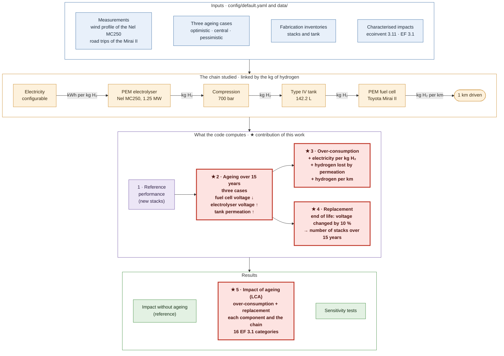

# h2-ageing-lca

**English** | [Français](README.fr.md)

**How much does stack ageing change the life cycle assessment of a hydrogen mobility chain?**

[](https://github.com/Ayabh12/h2-ageing-lca/actions/workflows/tests.yml)
Code: MIT · Data: CC BY 4.0

This repository contains the models, data and code of a life cycle assessment (LCA) that accounts for the ageing of the electrochemical stacks of a hydrogen chain: a PEM electrolyser, compression, a type IV tank and a PEM fuel cell. Every result can be recomputed with one command, and every input can be changed in one configuration file.

---

## Contents

1. [Why this matters](#1-why-this-matters)
2. [Who can use it, and for what](#2-who-can-use-it-and-for-what)
3. [What the code does](#3-what-the-code-does)
4. [Quick start, without and with an ecoinvent licence](#4-quick-start-without-and-with-an-ecoinvent-licence)
5. [Documentation](#5-documentation)
6. [Main results](#6-main-results)
7. [Cite, licence, contact](#7-cite-licence-contact)

---

## 1. Why this matters

Most LCAs of hydrogen mobility treat the electrolyser and the fuel cell as if they never aged: the same efficiency for 15 years and a single stack. In reality, a stack loses performance with use and must be replaced at the end of its life. Ignoring this underestimates the impact, but by how much was not known.

This repository answers two questions:

- **How much?** The rise of the impact due to ageing, for each component alone and for the whole chain.
- **Through which route?** Ageing acts at two levels:
  1. **Over-consumption**: the aged fuel cell uses more hydrogen per km, the electrolyser more electricity per kg, and the tank loses more hydrogen.
  2. **Replacement**: a stack is replaced when its voltage has changed by 10 % (DOE criterion); each new stack adds its fabrication impact.

**The result in short.** Over the vehicle life (15 years, 200 000 km), stack ageing raises the climate change impact of the chain, compared with the same chain without ageing, by **+5.0 %** (optimistic case, DOE targets), **+31.1 %** (central case, current status measured by the DOE) and **+35.0 %** (pessimistic case, semi-empirical model and laboratory constants).

**What this repository brings**

- **A ready-to-use method.** The ageing models, the end-of-life search, the stack counting and the LCA are already linked, and every equation is documented with its source ([docs/METHOD.md](docs/METHOD.md)).
- **Any value or any inventory can be changed without rewriting the code.** The inputs are in one configuration file, the fabrication inventories in CSV tables; after a change, the end of life, the number of stacks and the impact are recomputed automatically.
- **Models built on real measurements**: a Toyota Mirai II fuel cell recorded on the road, and a Nel MC250 electrolyser following a wind production profile (public NLR data).
- **Usable without an ecoinvent licence**, and complete with one: both ways are described step by step ([section 4](#4-quick-start-without-and-with-an-ecoinvent-licence)).
- **Results checked automatically**: tests check the results at every change of the repository.
- **Open and bilingual**: every page exists in English and French, and anyone can reproduce the results or test their own case.

## 2. Who can use it, and for what

| You are | What you can do | Where to start |
|---|---|---|
| **LCA practitioner** | Add ageing to an LCA of hydrogen mobility; test your own electricity mix, horizon, inventories or stack counting rule | [docs/GUIDE.md](docs/GUIDE.md#5-worked-examples), examples 1–3 and 9 |
| **Engineer or manufacturer** | See what a longer stack lifetime or a slower degradation rate is worth in CO2-eq; find the lifetime threshold that removes one replacement | `scripts/threshold.py`, example 4 |
| **Researcher on degradation** | Plug in your own ageing constants or ageing law and see the effect on the LCA, without rewriting the LCA | [docs/GUIDE.md](docs/GUIDE.md#5-worked-examples), examples 5 and 7 |
| **Student** | Read a complete, small LCA model with ageing, run it, and modify it step by step | [docs/METHOD.md](docs/METHOD.md), then the notebooks |

## 3. What the code does



**Reading the diagram, step by step:**

1. **Reference performance**: from the measurements, the code fits the polarisation curve of the electrolyser and of the fuel cell when new.
2. **Ageing**: it ages each component over 15 years according to the chosen case: the fuel cell voltage falls, the electrolyser voltage rises, the tank permeation increases.
3. **Over-consumption**: from these changes, it computes what the chain consumes in addition:
   - the electrolyser needs more electricity per kg of hydrogen;
   - the tank loses more hydrogen by permeation;
   - the fuel cell uses more hydrogen per km, so more hydrogen must be produced and compressed.
4. **Replacement**: it finds the age at which the voltage has changed by 10 % (end of life), then the number of stacks needed over 15 years.
5. **Results (LCA)**: it multiplies the over-consumption and the number of stacks by the characterised impacts. This gives the impact of over-consumption and that of replacement, hence the rise due to ageing, for each component and for the chain, in the 16 EF 3.1 categories.

The boxes marked ★ are the contribution of this work. Each step is detailed in [docs/METHOD.md](docs/METHOD.md).

### The three ageing cases

| | Optimistic | Central | Pessimistic |
|---|---|---|---|
| Model | linear | linear | semi-empirical |
| Fuel cell | 8 000 h to end of life (DOE target) | 4 100 h (best fleet followed by the DOE, 2006–2016) | laboratory constants (Colombo et al. 2023): end of life at 2 895 h |
| Electrolyser | 2.3 µV/h per cell (DOE 2026 target) | 4.8 µV/h (DOE 2022 status) | laboratory constants (Padgett et al. 2025; Chandesris et al. 2015) |
| Tank permeation (mL/h/L, from year 0 to 15) | 6 → 6 | 6 → 14 | 6 → 46 (UN R134 limit) |
| What it represents | what the technology aims for | the current state of real systems | an upper bound, on cells more stressed than commercial stacks |

The three cases are always given side by side; the central case is highlighted because it rests on real systems. The values and their sources are in `config/default.yaml`, the equations in [docs/METHOD.md](docs/METHOD.md).

## 4. Quick start, without and with an ecoinvent licence

| | Without an ecoinvent licence | With an ecoinvent licence |
|---|---|---|
| **You can change** | every input of the model, and the fabrication impact by giving your own value | in addition, the content of the fabrication inventories (materials, energy, ecoinvent datasets, place) |
| **You cannot** | recompute an impact from ecoinvent (changed inventory, new component, new electricity) | change the ecoinvent data themselves |
| **To install** | `requirements.txt` | `requirements.txt` and `requirements-brightway.txt` |

What can be changed is detailed in [docs/GUIDE.md](docs/GUIDE.md), section 3.

### Installation

Requirements: Python 3.10 or later, and Git (or download the repository as a ZIP: green **Code** button, **Download ZIP**).

**In a terminal** (Anaconda Prompt, PowerShell, macOS or Linux terminal):

```bash
git clone https://github.com/Ayabh12/h2-ageing-lca
cd h2-ageing-lca
pip install -r requirements.txt
python scripts/run.py                    # default configuration, about 2 s
python tests/test_reference_results.py   # 13 tests: the default configuration gives the reference results
```

**In Jupyter**, this method works everywhere, with or without Git installed. Copy these two cells into a new notebook:

```python
# cell 1: download the repository (no Git needed) and install, once
import sys, urllib.request, zipfile
urllib.request.urlretrieve("https://github.com/Ayabh12/h2-ageing-lca/archive/refs/heads/main.zip", "h2-ageing-lca.zip")
zipfile.ZipFile("h2-ageing-lca.zip").extractall(".")
%cd h2-ageing-lca-main
!{sys.executable} -m pip install -r requirements.txt
```

```python
# cell 2: run the model, then check the reference results
!{sys.executable} scripts/run.py
!{sys.executable} tests/test_reference_results.py
```

In Jupyter, `!` runs a terminal command, `%cd` enters a folder, and `{sys.executable}` is the Python of the notebook. If the folder already exists, only run `import sys` and `%cd h2-ageing-lca-main`. A ready-made notebook is also in [examples/adapt_the_model.ipynb](examples/adapt_the_model.ipynb).

**Next:**

- **without a licence**, change a value or a case: [docs/GUIDE.md](docs/GUIDE.md), sections 2 and 3;
- **with a licence**, recompute the fabrication impacts with Brightway (ecoinvent login, import, check): [docs/GUIDE.md](docs/GUIDE.md#34-fabrication), section 3.4.

## 5. Documentation

| Document | What you find there |
|---|---|
| [docs/METHOD.md](docs/METHOD.md) | every equation and its source, the LCA, the sensitivity, the detailed results |
| [docs/GUIDE.md](docs/GUIDE.md) | install, repository layout, change a value, everything that can be changed, reproduce every result, worked examples |
| [docs/LIMITS.md](docs/LIMITS.md) | the limits, their effect and the validity domain |
| [data/README.md](data/README.md) | the sources and licences of each data file |
| [data/inventories/README.md](data/inventories/README.md) | the fabrication inventories and their ecoinvent datasets |
| [examples/](examples/) | Jupyter notebooks ready to run |
| [notebooks/](notebooks/README.md) | original research notebooks |

## 6. Main results

Default configuration: climate change (EF 3.1), French residual mix (79.6 g CO2-eq/kWh, AIB 2024 data), 200 000 km over 15 years. "No ageing": the same chain with stacks that never age. Each value includes use and fabrication.

| | No ageing | Optimistic | Central | Pessimistic |
|---|---|---|---|---|
| Fuel cell stacks over 15 years | 1 | 1 | 2 | 2 |
| Electrolyser stacks over 15 years | 1 | 2 | 3 | 3 |
| Electrolyser alone (kg CO2-eq/kg H2) | 4.31 | 4.53 (+5.1 %) | 4.57 (+5.9 %) | 4.66 (+8.2 %) |
| Tank alone (g CO2-eq/km) | 11.89 | 11.89 (0.0 %) | 12.04 (+1.3 %) | 12.64 (+6.4 %) |
| Fuel cell alone (g CO2-eq/km) | 61.9 | 63.4 (+2.4 %) | 82.2 (+32.8 %) | 83.4 (+34.6 %) |
| **Whole chain (g CO2-eq/km)** | **74.1** | **77.8 (+5.0 %)** | **97.2 (+31.1 %)** | **100.1 (+35.0 %)** |

- **The fuel cell is dominated by replacement**: in the central case, 91 % of its rise comes from the second stack.
- **The electrolyser is dominated by over-consumption**: one stack is spread over 1.19 million kg of hydrogen, the extra electricity weighs more.

Detailed breakdown (use and fabrication, two routes per component) and explanation of each point: [docs/METHOD.md](docs/METHOD.md#7-detailed-results). Limits and validity domain: [docs/LIMITS.md](docs/LIMITS.md).

## 7. Cite, licence, contact

- **Cite:** see [CITATION.cff](CITATION.cff) (GitHub shows a "Cite this repository" button).
- **Licence:** code under MIT ([LICENSE](LICENSE)); data and documentation under CC BY 4.0 ([LICENSE-DATA.md](LICENSE-DATA.md)). Third-party sources keep their own terms ([data/README.md](data/README.md)).
- **Questions, errors or new data:** please open an issue on GitHub. Contributions of measured degradation data for commercial stacks are especially welcome, since they would replace the bracketing cases by a measurement.
